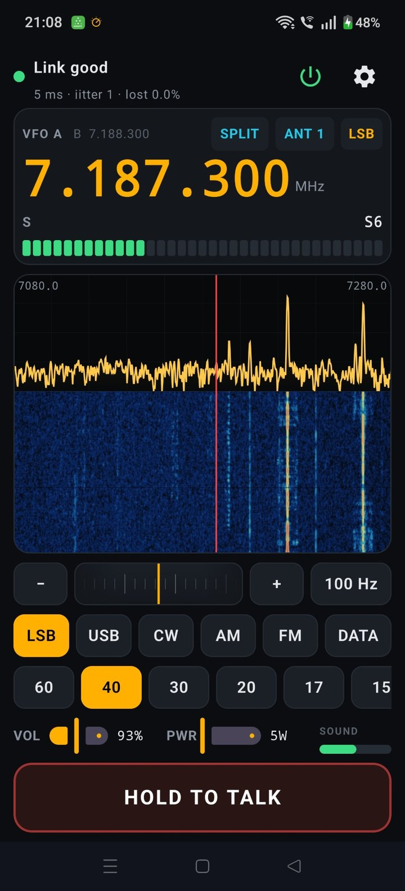
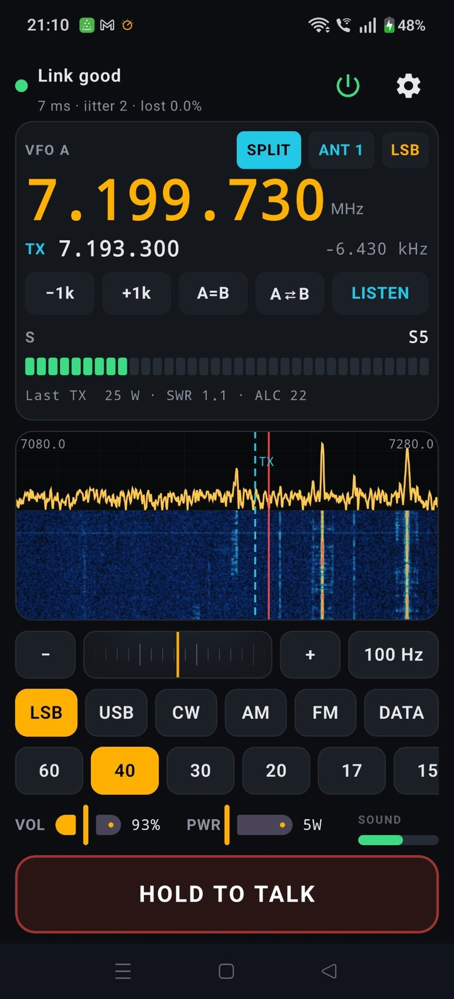
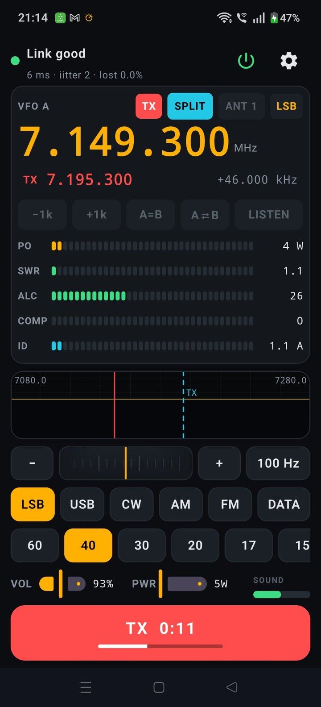
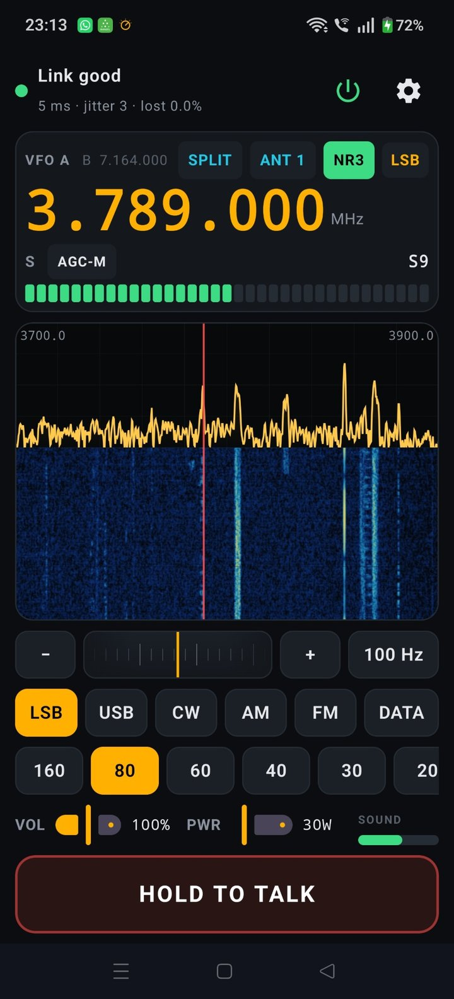
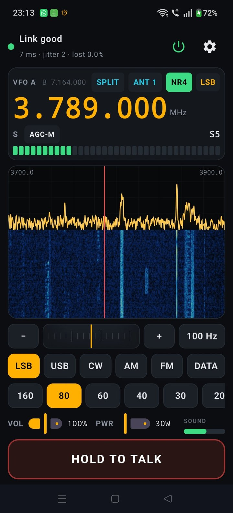
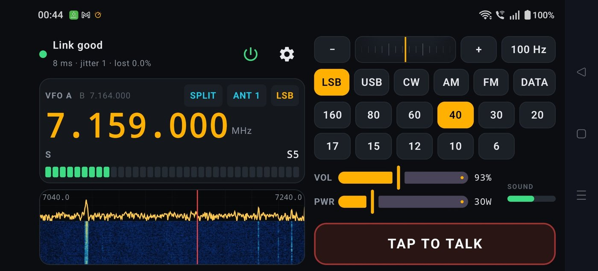

# TS-890S Mobile

Your Kenwood TS-890S on your Android phone or tablet, from anywhere: the
frequency, bandscope and waterfall, the radio's sound with NR3 or NR4 noise
reduction, AGC, transmitting from the phone's microphone, split, and
switching the radio on and off.

  
  
  

  
  

TS-890S Mobile reaches the radio through the **TS-890S Remote Relay**, the
same small program on a Raspberry Pi (or PC) at home that
[TS-890S Desktop](https://github.com/lmacc/Kenwood-TS-890-Client-TCI-Server-v2)
uses. Your phone and the Pi find each other over **Tailscale**, a free,
private network between your own devices, built into the app. Nothing is
opened on your router.

## Download

**[The latest release](https://github.com/lmacc/TS-890S-Mobile-Releases/releases/latest)**,
under **Assets**:

- **TS-890S-Mobile-….apk**: the app. Download it on the phone and tap it to
  install. The first time, Android asks you to allow installing from this
  source.
- **TS-890S-Mobile-Guide.pdf**: the user guide. It covers installing the
  app, setting up Tailscale on the phone, connecting to the relay, and
  everything on the screen.
- **libspecbleach-….-source.zip**: the source of NR4's noise reduction
  library, offered under its licence (LGPL). You don't need it to use the
  app.
- **SHA256SUMS.txt**: a checksum for the APK, so a copy found anywhere else
  can be told from the one released here.

**Updating:** install the new APK over the top. Don't uninstall the old one
first: that deletes the app's Tailscale sign-in, your radio password and your
licence.

## What you need

- A TS-890S on your home network, with **KNS Operation** set to **On (LAN)**
  or **On (Internet)**.
- The **Remote Relay** from TS-890S Desktop **2.4.19 or later**, running at
  home on a Raspberry Pi or a PC, with Tailscale. Section 24 of the TS-890S
  Desktop user guide covers installing it.
- A free **Tailscale** account: the same one the Pi is signed in to.
- A phone or tablet with **Android 8** or later.

## Free trial

The app works fully for 14 days. After that it is unlocked with a key: a
TS-890S Desktop donor's key unlocks it too, or donate and send the phone's
code shown in the app for a key of its own. Section 10 of the user guide has
the details.

## Problems and suggestions

Please open an [issue](https://github.com/lmacc/TS-890S-Mobile-Releases/issues).
The app's **Settings, Connection log** usually shows what happened: include
its last lines.

Try transmitting into a dummy load first.

73, Leslie EI5GJB
